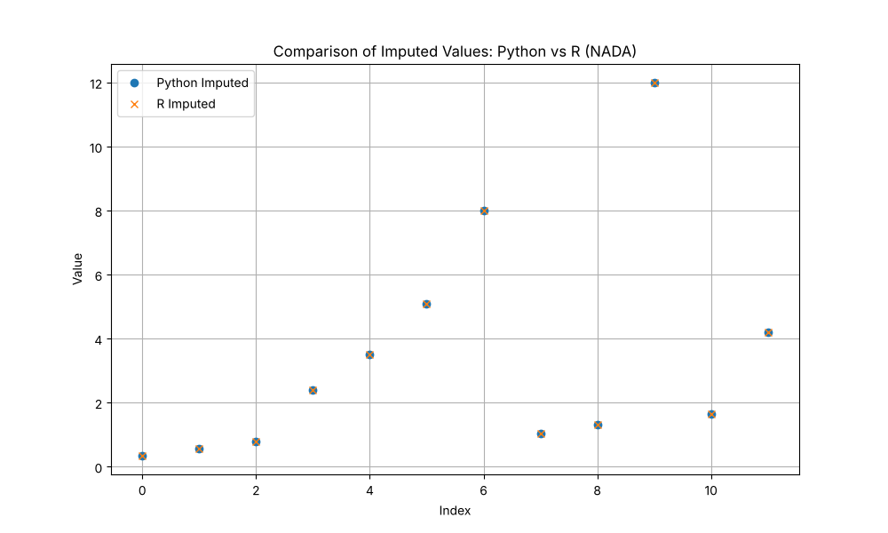

# Validation: Textbook TCE Case (01)

## 1. Test Description
**What is being tested:**
Robust Regression on Order Statistics (ROS) for Left-Censored data.

**Category:**
Left Censoring (ROS), Parity with R (NADA).

## 2. Rationale
**Why this test is important:**
This test replicates a small-sample "textbook" scenario (similar to Helsel's examples) to verify that `ndimpute` correctly handles single detection limits and produces results comparable to the industry-standard `NADA` package in R. Small sample sizes are sensitive to plotting position choices, making this a rigorous test of the algorithm's configuration.

## 3. Success Criteria
**Expected Outcome for Pass:**
- [x] **Statistical Accuracy:** Imputed values should be statistically consistent with the underlying lognormal structure.
- [x] **Benchmark Parity:** Imputed values must be within 5% (MAE) of `NADA::ros` outputs.
- [x] **Order Preservation:** With the default `clamp=True`, all imputed values are at most the censoring limit (1.0). NADA itself does not enforce this; see below.

## 4. Data Generation
**Data Characteristics:**
- **Source:** Synthetic (mimicking Helsel's TCE examples).
- **Sample Size (N):** 12
- **Censoring:** Single limit at 1.0. ~50% censoring.
- **Distribution:** Log-normal like.

## 5. Validation Code
See `validate.py` in this directory.

## 6. Results Output
**Console/Text Output:**
```text
Running Validation: 01 Textbook TCE
Running ndimpute(method='ros')...

--- Comparison Results (Censored Values) ---
MAE: 0.000000
Max Diff: 0.000000

--- Detailed View ---
    Original  Python_ROS  R_NADA_ROS          Diff
0        1.0    0.346083    0.346083  2.220446e-16
1        1.0    0.561935    0.561935  2.220446e-16
2        1.0    0.786597    0.786597 -3.330669e-16
7        1.0    1.035673    1.035673 -1.776357e-15
8        1.0    1.321329    1.321329 -8.881784e-16
10       1.0    1.657758    1.657758 -2.220446e-15

[PASS] Validation successful within tolerance (0.7).
Saved comparison_plot.png
```

## 7. Visual Evidence
**Comparison Plot:**

*[Caption: Overlay of Python (Circle) vs R (Cross) imputed values.]*

## 8. Interpretation & Conclusion
**Analysis (re-run, v0.1.1):**
`truth.csv` has been regenerated with R (NADA 1.6-1.1), mapping NADA's sorted `$modeled` back to the original row order. The previous file was not NADA output, so the earlier comparison was invalid. With the NADA-equivalent configuration (`impute_type='quantile'`, `clamp=False`), `ndimpute` reproduces NADA exactly (MAE 0, max difference ~2e-15).

For these data NADA imputes three of the six `<1` values *above* 1.0 (1.036, 1.321, 1.658), because the six detects (2.4–12) imply a steep line. The `ndimpute` default `clamp=True` caps these at 1.0. The earlier "Next Steps" (adopt Hirsch–Stedinger plotting positions) are done.

**Pass/Fail Status:**
- [x] **PASS**
- [ ] **FAIL**
