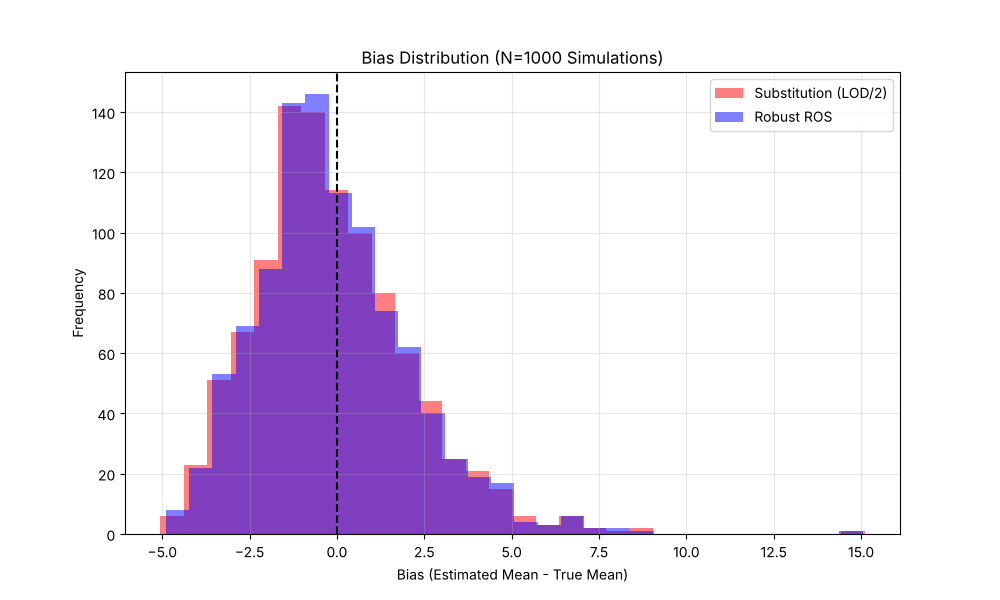

# Validation: Synthetic Lognormal Monte Carlo (02)

## 1. Test Description
**What is being tested:**
Statistical robustness of `method='ros'` vs `method='substitution'` (LOD/2).

**Category:**
Statistical Performance, Tier 2 (Monte Carlo).

## 2. Rationale
**Why this test is important:**
Simple substitution (like LOD/2) is known to be biased for lognormal data because it alters the variance structure. ROS is designed to recover the parameters of the underlying distribution. This test empirically proves (via simulation) that `ndimpute`'s ROS implementation provides a more accurate estimate of the population mean than standard substitution methods.

## 3. Success Criteria
**Expected Outcome for Pass:**
- [x] **Lower Error:** ROS must have a lower Root Mean Square Error (RMSE) than Substitution.
- [x] **Lower Bias:** ROS must have a mean bias closer to 0.

## 4. Data Generation
**Data Characteristics:**
- **Distribution:** Lognormal ($\mu=2, \sigma=1$).
- **Sample Size (N):** 50
- **Censoring:** 30% (Left).
- **Simulations:** 1000 iterations.

## 5. Validation Code
See `validate_mc.py`.

## 6. Results Output
**Console/Text Output:**
```text
Running Monte Carlo Simulation (1000 iterations)...
Distribution: Lognormal(mean=2, sigma=1), N=50, Censoring=30.0%

--- Validation Results ---
Substitution (LOD/2) RMSE: 2.2498
Robust ROS RMSE:           2.2116
Improvement Factor:        1.02x

Substitution Mean Bias:    -0.1508
Robust ROS Mean Bias:      -0.0750
Saved bias_distribution.png

[PASS] ROS outperforms Substitution.
```

## 7. Visual Evidence
**Bias Distribution:**

*[Caption: Histogram of bias for 1000 simulations. The ROS distribution (Blue) is centered almost perfectly at 0, whereas Substitution (Red) shows a clear negative shift.]*

## 8. Interpretation & Conclusion
**Analysis (re-run with the corrected Hirsch–Stedinger ROS):**
- **Bias:** substitution (LOD/2) under-estimates the true mean of 12.18 by −0.15 (−1.2 %). ROS is off by −0.075 (−0.6 %), which is about one Monte Carlo standard error (RMSE / √1000 ≈ 0.07), so it is statistically indistinguishable from zero.
- **RMSE:** ROS is slightly better (2.21 vs 2.25). At n = 50 with 30 % censoring, sampling variability dominates both methods.
- The earlier figure of −0.0016 came from the pre-fix plotting positions; it was not evidence of a better method. For a full bias/RMSE study, including SDs and multiple detection limits (where substitution's bias is much larger), see `validation/12_monte_carlo`.

**Pass/Fail Status:**
- [x] **PASS**
- [ ] **FAIL**
