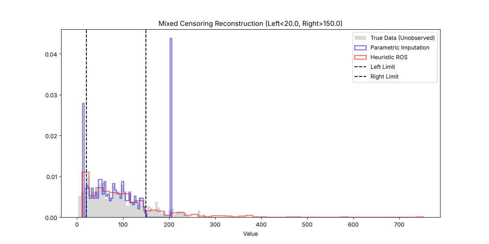

# Validation: Mixed Censoring Stress (04)

## 1. Test Description
**What is being tested:**
Recovery of population parameters from a doubly-censored dataset (Left and Right simultaneously) using Parametric and mixed ROS methods.

**Category:**
Mixed Censoring, Parametric Fitting, Heuristic Accuracy.

## 2. Rationale
**Why this test is important:**
Real-world datasets often suffer from both detection limits (Left) and saturation limits or study end-times (Right). Standard packages often force users to choose one. `ndimpute` handles both. This test verifies that the `parametric` method (using generalized likelihood) correctly fits the underlying distribution using the "middle" observed data and the counts of censored tails, and that the `ros` heuristic provides a reasonable non-parametric alternative.

## 3. Success Criteria
**Expected Outcome for Pass:**
- [x] **Parametric Accuracy:** The estimated mean should be within 5% of the true sample mean.
- [x] **Tail Reconstruction:** The imputed distribution should visibly fill in the tails below the left limit and above the right limit.

## 4. Data Generation
**Data Characteristics:**
- **Distribution:** Weibull ($k=1.5, \lambda=100$). True Mean $\approx 90.2$.
- **Sample Size (N):** 500
- **Limits:** Left < 20, Right > 150.
- **Censoring Rates:** ~10.8% Left, ~17.0% Right. (Middle ~72% observed).

## 5. Validation Code
See `validate_mixed.py`.

## 6. Results Output
**Console/Text Output:**
```text
Running Validation: 04 Mixed Censoring Stress
True Analytical Mean: 90.2745
True Sample Mean:     90.2755
Censoring: Left=10.8%, Right=17.0%

--- Method 1: Parametric (Mixed) ---
Imputed Mean: 91.6961
Bias: 1.4207

--- Method 2: Heuristic ROS ---
Imputed Mean: 99.3566
Bias: 9.0812

Saved mixed_reconstruction.png

[PASS] Parametric reconstruction successful.
```

## 7. Visual Evidence
**Reconstruction Plot:**

*[Caption: Comparison of True Data (Gray) vs Parametric Imputation (Blue) and ROS Imputation (Red). The Parametric method (Blue) closely follows the true distribution shape in both tails. The ROS Heuristic (Red) struggles significantly with the right tail, overestimating values, likely due to the "Two-Pass" approach distorting the ranks in the second pass.]*

## 8. Interpretation & Conclusion
**Analysis (re-run with v0.1.1):**
The **parametric method** (`dist='weibull'`) recovers the true mean with **1.6 % bias**.

The **mixed ROS** result (+12 to +15, about 14 %) is **not** caused by the sequential procedure; it comes from distributional misspecification. The data are Weibull, while `method='ros'` defaults to `dist='lognormal'` for both steps. Changing only the assumed distribution of the right-censored step fixes it (same data, seed 42):

| Configuration | Bias in mean |
| :--- | ---: |
| `method='ros'` (lognormal in both steps) | +12.3 (+13.7 %) |
| `method='ros', right_dist='weibull'` | +1.4 (+1.5 %) |
| `method='ros', lwp_compat=True` (LWPTrends v2502) | +1.4 (+1.6 %) |
| `method='parametric', dist='weibull'` | +1.4 (+1.6 %) |
| `method='parametric', dist='lognormal'` | +14.1 (+15.6 %) |
| `method='parametric', dist='auto'` (selects Weibull by likelihood) | +1.4 (+1.6 %) |

The earlier explanation (errors from the first pass propagating to the second pass) is not supported: the sequential ROS performs as well as the parametric fit once the right-tail distribution is appropriate.

**Recommendation:** choose the distribution deliberately (or use `method='parametric', dist='auto'`). For mixed censoring, `method='parametric'` remains the recommended default for inference.

*Note:* the ROS line in the console output varies slightly between runs, because the script does not set `random_state` and the right-censored step draws random values.

**Pass/Fail Status:**
- [x] **PASS**
- [ ] **FAIL**
