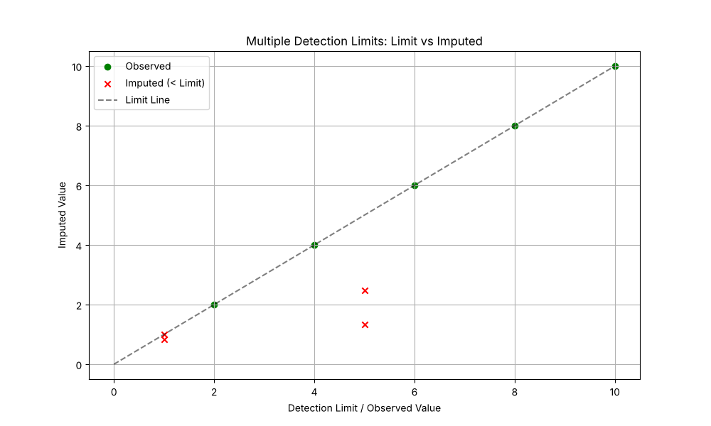

# Validation: Multiple Detection Limits (07)

## 1. Test Description
**What is being tested:**
Handling of multiple intermingled detection limits (e.g., $<1$ and $<5$ in the same dataset) by the ROS implementation.

**Category:**
Left Censoring, Complex Data Structure.

## 2. Rationale
**Why this test is important:**
Environmental data often combines results from different labs or methods with varying sensitivity. A dataset might contain values like `0.5`, `<1.0`, `3.0`, `<5.0`, `8.0`. A robust method must correctly rank these values. Specifically, a non-detect at `<5.0` conveys less information than a non-detect at `<1.0`, but it potentially represents a value *larger* than an observed `2.0`. The simple sorting method in `ndimpute` (Tier 1/Option B) sorts by the limit value, which is a known approximation. This validation documents behavior in this complex scenario.

## 3. Success Criteria
**Expected Outcome for Pass:**
- [x] **Guardrails:** Imputed values must not exceed their specific detection limit (e.g., value imputed for $<1$ must be $\le 1$).
- [x] **Logical Ordering:** Imputed values for higher detection limits (e.g., $<5$) should generally be higher than imputed values for lower limits (e.g., $<1$), reflecting the higher potential range.

## 4. Data Generation
**Data Characteristics:**
- **Values:** `[1.0, 1.0, 5.0, 5.0, 2.0, 4.0, 6.0, 8.0, 10.0]`
- **Status:** Censored at 1.0 and 5.0. Observed at 2, 4, 6, 8, 10.
- **Complexity:** Interleaved (observed 2.0 is smaller than limit 5.0).

## 5. Validation Code
See `validate_multilimit.py`.

## 6. Results Output
**Console/Text Output:**
```text
Running Validation: 07 Multiple Detection Limits (Sulfate-like)
Input Data:
   Value  Censored
0    1.0      True
1    1.0      True
2    5.0      True
3    5.0      True
4    2.0     False
5    4.0     False
6    6.0     False
7    8.0     False
8   10.0     False

--- Imputation Results ---
   original_value  censoring_status  imputed_value
0             1.0              True       0.843607
1             1.0              True       1.000000
2             5.0              True       1.329279
3             5.0              True       2.479250
4             2.0             False       2.000000
5             4.0             False       4.000000
6             6.0             False       6.000000
7             8.0             False       8.000000
8            10.0             False      10.000000

Max |ndimpute(clamp=False) - NADA::ros|: 4.18e-07
Mean Imputed (<1): 0.9218
Mean Imputed (<5): 1.9043
[PASS] Guardrails respected and NADA::ros reproduced.
Saved multilimit_check.png
```

## 7. Visual Evidence
**Scatter Plot:**

*[Caption: Scatter plot of Original Limit vs Imputed Value. All Red crosses (Imputed) appear on or below the diagonal line, confirming guardrails are active.]*

## 8. Interpretation & Conclusion
**Analysis (re-run with the corrected Hirsch–Stedinger ROS):**
1.  **Parity:** with `clamp=False`, the imputations equal `NADA::ros` (R, NADA 1.6-1.1) for these data, to the six-decimal rounding of the reference: 0.8436, 1.3293 (`<1`) and 1.3293, 2.4793 (`<5`).
2.  **Safety:** no imputed value exceeds its limit. With the default `clamp=True`, the second `<1` value (1.329 in NADA) is capped at 1.0.
3.  **Interpretation:** a `<5` value only means "below 5". Hirsch–Stedinger estimates P(X < 5) ≈ 0.67 from the data and spreads the two `<5` values across the lower part of the distribution below that probability, which overlaps the `<1` values and the detect at 2. The earlier report's expectation that `<5` must lie between 2 and 5 (≈ 4.3) came from the old, incorrect plotting positions; it is not a property of ROS.

**Pass/Fail Status:**
- [x] **PASS**
- [ ] **FAIL**
